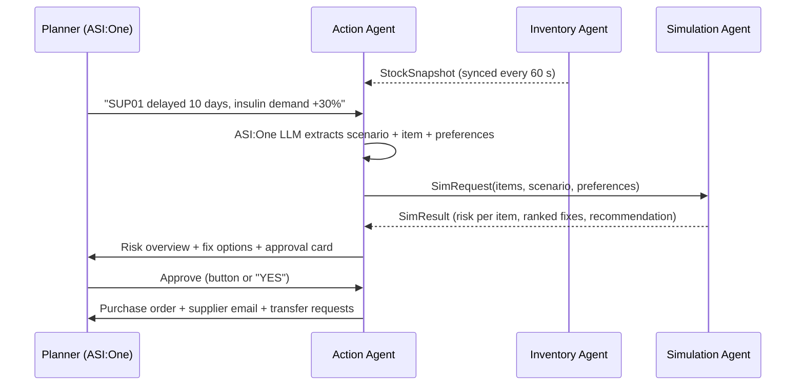

# MediTwin: a Digital Twin for the Medical Supply Chain


> **Hospitals find out about a medicine shortage when the shelf is empty.**
> MediTwin is a three-agent system on Agentverse that keeps a live digital twin of a hospital's supply chain, simulates a disruption *before* it hits, and turns the result into an approved purchase order, supplier email and inter-hospital transfer request, all inside one ASI:One conversation.

Built for **Fetch-A-Thon 3.0 (GCET Edition)**, challenge: *ASI:One Agent Challenge: From Intent to Action*.

---

## Verify it in 60 seconds

1. Open [ASI:One](https://asi1.ai/) and send:
   `@supply-chain-action What if SUP01 is delayed 10 days and insulin demand rises 30%?`
2. Within ~15 seconds the Action Agent calls the Simulation Agent (using stock synced from the Inventory Agent) and replies: **insulin critical, 100% stockout probability**, with ranked fixes.
3. Reply `YES` (or click **Approve & draft PO** on the card). You receive a **purchase order for 754 vials from Himalaya MedSupply, a supplier email, and transfer requests to two sister hospitals**, total Rs 364,920, residual risk 0%.

Every number is produced by deterministic, seeded code, so you can repeat the request and get the same result.

## Quick links

| Item | Link |
|---|---|
| ASI:One shared chat (full demo workflow) | `[PASTE PUBLIC ASI:ONE CHAT URL]` |
| Demo video | `[PASTE VIDEO URL]` |
| Action Agent (entry point) | [Agentverse profile](https://agentverse.ai/agents/details/agent1qt5pyuj973nk3rz8q3r8nxckk2kv3xr9zuw7qj8j3vuqa7h7lqu0jzqwjmj/profile) |
| Inventory Agent | [Agentverse profile](https://agentverse.ai/agents/details/agent1qw5sdhru2eml9w08k65waf0rnqpxz6xazqvcmnen57t4p75gvgegjke70eg/profile) |
| Simulation Agent | [Agentverse profile](https://agentverse.ai/agents/details/agent1q229ftx9ae3vlwjy87hw7cnvaa6dm8g99q5lh0ky5e824kz69xcage63jj3/profile) |
| Full documentation | [`docs/`](docs/README.md) |

## Agent registry

| Agent | Name on Agentverse | Address | Role |
|---|---|---|---|
| **Action Agent** | `Supply Chain Action Agent` (`@supply-chain-action`) | `agent1qt5pyuj973nk3rz8q3r8nxckk2kv3xr9zuw7qj8j3vuqa7h7lqu0jzqwjmj` | ASI:One entry point, orchestrator, personal agent |
| **Inventory Agent** | `meditwin-inventory` | `agent1qw5sdhru2eml9w08k65waf0rnqpxz6xazqvcmnen57t4p75gvgegjke70eg` | Digital-twin state (stock, demand, suppliers) |
| **Simulation Agent** | `meditwin-simulation` | `agent1q229ftx9ae3vlwjy87hw7cnvaa6dm8g99q5lh0ky5e824kz69xcage63jj3` | Monte Carlo what-if engine and fix ranking |

All three are **hosted on Agentverse**. Only the Action Agent needs to be discovered in ASI:One; it reaches the other two by address.

---

## 1. The problem

Medical stockouts are rarely sudden. A supplier slips, demand rises, a cold-chain unit fails, and by the time the pharmacy notices, the lead time to fix it is longer than the stock that remains. Procurement teams work from spreadsheets and phone calls and cannot easily ask: *"If this supplier is late, which critical items run out, when, and what is the cheapest safe fix?"*

**Target users:** hospital pharmacy and procurement managers, store in-charges and supply-chain planners in small and mid-sized hospitals.

**Outcome:** a ranked set of fixes (order, expedite, inter-hospital transfer, or a combined bridge plan), each with a simulated stockout probability and cost, followed by an approved purchase order, a supplier email and transfer requests.

## 2. Intent to action, in one conversation



| Step | Who | What happens |
|---|---|---|
| Understand | Action Agent + **ASI:One LLM** | Free text becomes a structured scenario (supplier, delay, per-item demand change, spoilage), a focus item and preference updates. The LLM also recognises commentary that is not a new instruction, so no unwanted runs are triggered. |
| Sense | Inventory Agent | Serves the twin state as typed `StockSnapshot` messages; the Action Agent keeps a synced copy so user requests skip a network hop. |
| Simulate | Simulation Agent | 1,000-run Monte Carlo per option over 21 days; returns risk, unmet units and a recommended plan. |
| Decide | User | Approves the recommended plan, picks another option, or cancels. Nothing is ordered without approval. |
| Act | Action Agent | Generates the purchase order, supplier email and sister-hospital transfer requests, and records the order. |

**Design principle:** the LLM understands intent; **all numbers come from deterministic, testable code**, never from the LLM.

## 3. Why MediTwin fits each prize category

### Best Multi-Agent Workflow
- **Three specialised agents with typed contracts**: `StockRequest`/`StockSnapshot` and `SimRequest`/`SimResult` models shared byte-for-byte, so schemas cannot drift silently.
- **Separation of concerns:** state (Inventory), computation (Simulation), reasoning and action (Action Agent). Each can be replaced independently, for example swapping the Inventory Agent for an ERP connector.
- **Fault tolerance between agents:** request IDs with a watchdog; if the Inventory Agent is silent for 15 s the Simulation Agent's stored snapshot is used and the user is told; if the Simulation Agent is silent for 40 s the user gets a clear message instead of a hang. Late or duplicate replies are ignored by request ID.

### Best Personal AI
- **Remembers you:** preferred suppliers and budget cap are stored per user and applied to every later simulation. Saying *"prefer LifeLine Biologics, budget 5 lakh"* re-runs your last scenario with the new preferences automatically.
- **Daily risk brief:** "give me today's risk brief" lists the tightest items first.
- **Human in the loop:** every action needs explicit approval (YES / option N / NO, or the approval card).
- **Order history** is kept per user.

### Best Agentverse Deployment
- **All three agents run hosted on Agentverse**, with the Agent Chat Protocol and a published manifest on the Action Agent.
- **Uses the ASI:One LLM injected into hosted agents** (`ASI1_API_KEY`, `ASI1_BASE_URL`) as the intent engine, with a circuit breaker: on a quota or authentication error the LLM is paused for 10 minutes and a strict keyword parser takes over, so the agent never stops answering.
- **Tuned for the hosted runtime:** non-critical state kept in memory because hosted storage calls are slow; inventory synced on an interval; message de-duplication; replies close the session with `EndSessionContent`. Measured agent-side latency is about 8 to 14 seconds per request (Simulation Agent round trip about 1 to 2 seconds).
- **ASI Interactive Card:** fix options are sent as a carousel card (one slide per plan with an *Approve & draft PO* button) through `MetadataContent`. Clicks are parsed as selection JSON first, then as planner prose; the full text answer is always sent too, so clients without card support still work.

## 4. The simulation model

Implemented in [`src/sim.py`](src/sim.py), pure Python standard library.

| Concept | How it is modelled |
|---|---|
| Scenario | Preset (`SC1`..`SC3`) or custom: delayed supplier and days, per-item or global demand multiplier, cold-chain spoilage |
| Demand | Daily demand ~ Normal(mean x multiplier, std x multiplier), floored at 0 |
| Supplier reliability | With probability `1 - reliability`, a delivery arrives 3 days late |
| Horizon | 21-day window, 1,000 runs per evaluation, fixed seed so options are compared on identical random draws |
| Order sizing | `demand x 21 x 1.15 safety factor - available stock` |
| Fix options | Supplier order, expedited order (lead x0.5, cost x1.2), transfer from a sister hospital, bridge (transfer + order) |
| Risk score | `stockout_probability x criticality / 5 x 100` (critical >= 60, high >= 30, medium >= 10) |
| Recommendation | Cheapest within-budget plan with stockout probability <= 5%, preferring the user's preferred suppliers |

All assumptions are constants at the top of `sim.py` and are returned in every result. Full derivation: [docs/simulation-model.md](docs/simulation-model.md).

### Verified result: hero scenario `SC1`
Supplier `SUP01` delayed 10 days and insulin demand +30%:

```
Insulin Glargine: 11.5 days of cover, delayed supplier lead 17 days
  -> stockout probability 100%, risk 100 (critical)

Recommended: Bridge = transfer 150 + 80 vials from sister hospitals
             + order 754 vials from Himalaya MedSupply (6 days)
  -> stockout probability 0%, Rs 364,920
Alternatives: order only from Himalaya (Rs 472,320), from LifeLine (Rs 511,680)
```

**Cascade detection:** the same `SUP01` delay also raises Heparin to 8% stockout probability, because one supplier serves several items. A per-item spreadsheet would miss this.

## 5. Example conversation (actual behaviour)

```text
User:   Give me today's risk brief.
Agent:  Risk overview: 0 critical, 0 high, 0 medium, 12 low.
        Tightest: Medical Oxygen 8.6 days of cover, Heparin 15.9 days ...

User:   What if SUP01 is delayed 10 days and insulin demand rises 30%?
Agent:  Risk overview: 1 critical ... Insulin: 11.5 days of cover, stockout risk 100%.
        1. Bridge: transfer from sister hospitals + order from Himalaya MedSupply (6d)
           | risk 0% | Rs 364,920  <- recommended
        2. ...   Reply YES, option N, or NO.   [approval card]

User:   YES
Agent:  Purchase order PO-20261024-XXXX: 754 vials from Himalaya MedSupply ...
        Email to Himalaya MedSupply ...
        Transfer request to District Hospital Noida: 150 units ...
        Transfer request to Ghaziabad Community Hospital: 80 units ...

User:   From now on prefer LifeLine Biologics.
Agent:  Saved your preferences ... Re-running your last scenario:
        recommended bridge via LifeLine Biologics (4d), Rs 395,080, risk 0%.
```

## 6. Challenge requirements

| Requirement | Status | Evidence |
|---|---|---|
| At least one agent registered on Agentverse | Done (3) | Agent registry above |
| Agent Chat Protocol | Done | [`src/agents/action-agent.py`](src/agents/action-agent.py) |
| Usable from ASI:One, full workflow in chat, no custom frontend | Done | Shared chat link above |
| Meaningful tool execution / multi-agent orchestration | Done | Inventory -> Simulation -> PO generation |
| Public repo with run instructions | Done | Section 8, [deployment guide](docs/deployment-and-run-guide.md) |
| `innovationlab` and `hackathon` badges | Done | Top of this README |

| Bonus | Status |
|---|---|
| Multi-agent collaboration | Done: 3 agents, typed agent-to-agent messages |
| Error handling and recovery | Done: watchdog timeouts, snapshot fallback, LLM circuit breaker, de-duplication, crash-safe handlers |
| ASI Interactive Cards | Implemented: carousel approval card with text fallback |
| Real-time data | Inventory synced every 60 s; external signals (weather, shortage notices) on the roadmap |
| Payment Protocol | Not in this submission |
| Keeps operating after the hackathon | Yes: hosted agents; data layer swappable for an ERP API |

## 7. Documentation

| Document | What it covers |
|---|---|
| [docs/README.md](docs/README.md) | Documentation index |
| [docs/architecture.md](docs/architecture.md) | System topology, sequence diagrams, fault tolerance |
| [docs/agent-spec.md](docs/agent-spec.md) | Message models, chat protocol handling, card payloads |
| [docs/simulation-model.md](docs/simulation-model.md) | Monte Carlo model, formulas, assumptions |
| [docs/dataset-and-twin-schema.md](docs/dataset-and-twin-schema.md) | Items, suppliers, sister hospitals, ERP mapping |
| [docs/deployment-and-run-guide.md](docs/deployment-and-run-guide.md) | Local and Agentverse setup, testing, troubleshooting |

## 8. Running and testing

**Repository layout**

```text
.
├── README.md
├── requirements.txt
├── src/
│   ├── sim.py                     # Monte Carlo simulation engine (stdlib only)
│   ├── main.py                    # Entry runner
│   ├── dataset/data.json          # Synthetic hospital twin
│   └── agents/
│       ├── action-agent.py        # ASI:One entry point, orchestrator, personal agent
│       ├── inventory-agent.py     # Twin state
│       └── simulation-agent.py    # What-if engine wrapping sim.py
└── docs/                          # See section 7
```

**Simulation engine (no dependencies)**

```python
import json
from sim import run_simulation, format_text   # run from src/

data = json.load(open("dataset/data.json"))
result = run_simulation(data, {"scenario": "SC1", "item": "insulin"})
print(format_text(result))
```

Request format:

```json
{"scenario": "SC1", "item": "insulin",
 "preferences": {"preferred_suppliers": ["SUP02"], "budget_cap_inr": 600000},
 "runs": 1000, "seed": 42}
```

`scenario` can also be custom, e.g. `{"supplier_id": "SUP04", "delay_days": 6, "demand_multiplier": 1.5}`.

**Agents**
1. Deploy `inventory-agent.py` and `simulation-agent.py` as hosted agents on Agentverse and note their addresses.
2. Set `INVENTORY_ADDR` and `SIMULATION_ADDR` in `action-agent.py`, deploy it, and confirm the log shows `Inventory synced: 12 items`.
3. Chat with `@supply-chain-action` in ASI:One. `ASI1_API_KEY` and `ASI1_BASE_URL` are injected on hosted agents; without them the keyword parser is used.

**Tests run:** `SC1`, `SC2`, `SC3`, custom oxygen scenario (SUP04 delayed 6 days + demand x1.5 gives 96% stockout probability, critical), baseline, unknown item names, out-of-range numbers (clamped), invalid data (clean error), Inventory Agent offline (snapshot fallback), duplicate messages, LLM quota exhausted (keyword fallback). A full 12-item scan takes about 0.2 s.

## 9. Robustness

- Inputs validated and clamped (delay 0-90 days, multipliers 0.1-5, spoilage 0-100%; budgets below Rs 10,000 rejected).
- One bad record never breaks a report; it is skipped and listed in `warnings`.
- Fuzzy item matching ("O2 cylinder" and "oxygen" both resolve to the oxygen item).
- Deterministic by seed; options compared on identical random draws.
- Every handler is wrapped: an internal error still produces a reply to the user.

## 10. Limitations and responsible use

- **All data is synthetic.** Hospital, supplier and stock values are fictional.
- **Logistics decision support, not clinical advice.** MediTwin never recommends substitutes or treatments.
- Demand is modelled as normal and independent day to day; real demand has seasonality and correlation.
- Expedite premium, transfer cost and the 3-day late penalty are stated assumptions.
- Orders are drafted, not transmitted; a human approves every action.

## 11. Roadmap

1. Replace `data.json` with a live inventory/ERP connector behind the Inventory Agent.
2. External disruption signals (weather for cold-chain risk, logistics delays, shortage notices).
3. Learn per-item demand from history.
4. Payment Protocol for agent-to-agent purchase settlement.
5. Network-wide transfer optimisation across hospitals.

## 12. Team

| Name | Role |
|---|---|
| Vijay Singh | Agentverse agents, agent-to-agent messaging, Action Agent |
| Aryata Srivastava | Dataset, simulation engine, documentation |

Built at Fetch-A-Thon 3.0, GCET Edition, 24 October 2026.

