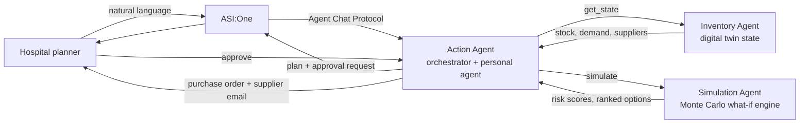

# MediTwin: a Digital Twin for the Medical Supply Chain


> **Hospitals find out about a medicine shortage when the shelf is empty.**
> MediTwin keeps a live digital twin of a hospital's supply chain, simulates disruptions *before* they hit, and turns the result into an approved, ready-to-send action, all inside a single ASI:One conversation.

Built for **Fetch-A-Thon 3.0 (GCET Edition)**, challenge: *ASI:One Agent Challenge: From Intent to Action*.

---

## Quick links

| Item | Link |
|---|---|
| ASI:One shared chat (full demo workflow) | `[PASTE PUBLIC ASI:ONE CHAT URL]` |
| Demo video | `[PASTE VIDEO URL]` |
| Action Agent (entry point) on Agentverse | `[PASTE AGENT PROFILE URL]` |
| Inventory Agent on Agentverse | `[PASTE AGENT PROFILE URL]` |
| Simulation Agent on Agentverse | `[PASTE AGENT PROFILE URL]` |

## Agent registry

| Agent | Handle | Address | Discoverable in ASI:One |
|---|---|---|---|
| Action Agent (orchestrator) | `[meditwin-action]` | `[agent1q...]` | Yes, **start here** |
| Inventory Agent | `[meditwin-inventory]` | `[agent1q...]` | Called by Action Agent |
| Simulation Agent | `[meditwin-simulation]` | `[agent1q...]` | Called by Action Agent |

> **Try it:** open [ASI:One](https://asi1.ai/), type `@[meditwin-action] Supplier SUP01 is delayed 10 days and insulin demand is up 30%. What happens and what should we do?`

---

## 1. The problem

Medical stockouts are rarely sudden. They are the end of a chain: a supplier slips, demand rises, a cold-chain unit fails, and by the time the pharmacy notices, the lead time to fix it is longer than the stock that remains. Procurement teams today juggle spreadsheets and phone calls, and cannot easily ask *"if this supplier is late, which of my critical items run out, when, and what is the cheapest safe fix?"*

**Target users:** hospital pharmacy and procurement managers, store in-charges, and supply-chain planners in small and mid-sized hospitals.

**Outcome our agents produce:** a ranked set of fixes (order, expedite, inter-hospital transfer, or a combined bridge plan), each with a simulated stockout probability and cost, then an approved purchase order and supplier email.

## 2. How it works



1. The planner describes a disruption in plain language.
2. The **Action Agent** uses the ASI:One LLM to extract the scenario (which supplier, how many days, which items, how much demand change).
3. It asks the **Inventory Agent** for the current twin state, then asks the **Simulation Agent** to run the what-if.
4. It ranks the fixes against the user's remembered preferences (budget cap, preferred suppliers), explains the trade-offs, and requests approval.
5. On approval it generates the purchase order and supplier email.

**Design principle:** the LLM understands intent and explains results; **all numbers come from deterministic, testable code**, never from the LLM. Results are reproducible and a judge can change an input and verify the output.

## 3. The agents

### Action Agent (front door, orchestrator, personal agent)
- Only agent the user talks to; discoverable through ASI:One.
- Extracts scenario from free text; orchestrates the two other agents.
- Ranks options, asks for approval, drafts the purchase order and supplier email.
- Remembers user preferences across the conversation (preferred suppliers, budget cap, risk tolerance).
- Falls back gracefully: if a downstream agent or API fails, it says what is missing and still returns what it has.

### Inventory Agent (the twin's state)
- Holds the hospital's state: 12 items, 7 suppliers (with reliability), lead times and costs, and 2 sister hospitals with spare stock.
- Answers state queries such as current stock, days of cover, and what is at risk.

### Simulation Agent (the what-if engine)
- Applies a scenario (supplier delay, demand surge, cold-chain spoilage) and runs a Monte Carlo simulation.
- Returns days of cover, stockout probability, expected unmet units, a criticality-weighted risk score, and simulated ranked fixes.

## 4. The simulation model

Implemented in [`sim.py`](src/sim.py), pure Python standard library, no external dependencies.

| Concept | How it is modelled |
|---|---|
| Scenario | Preset (`SC1`..`SC3`) or custom: delayed supplier and days, per-item or global demand multiplier, cold-chain spoilage percentage |
| Demand | Daily demand ~ Normal(mean x multiplier, std x multiplier), floored at 0 |
| Supplier reliability | With probability `1 - reliability`, a delivery arrives 3 days late |
| Horizon | 21-day planning window, 1,000 runs per evaluation, fixed seed for fair comparison between options |
| Order sizing | `demand x 21 x 1.15 safety factor - available stock` |
| Fix options | Supplier order, expedited order (lead x0.5, cost x1.2), transfer from sister hospital, bridge (transfer + order) |
| Risk score | `stockout_probability x criticality / 5 x 100` (critical >= 60, high >= 30, medium >= 10) |
| Recommendation | Cheapest within-budget plan with stockout probability <= 5%, preferring the user's preferred suppliers |

All assumptions are constants at the top of `sim.py`, and every result returns them in an `assumptions` field.

### Verified result: hero scenario `SC1`
Supplier `SUP01` delayed 10 days and insulin demand +30%:

```
Insulin Glargine: 11.5 days of cover, delayed supplier lead 17 days
  -> stockout probability 100%, risk 100 (critical)

Recommended: Bridge, transfer from sister hospitals + order from Himalaya MedSupply (6d)
  -> stockout probability 0%, Rs 364,920
Alternatives: order only from Himalaya (Rs 472,320), from LifeLine (Rs 511,680)
```

**Cascade detection:** the same `SUP01` delay also lifts Heparin to 8% stockout probability, because one supplier serves several items. A per-item spreadsheet would miss this.

## 5. How we meet the challenge requirements

| Requirement | Status | Where |
|---|---|---|
| Agents registered on Agentverse | `[ ]` | Agent registry above |
| Agent Chat Protocol implemented | `[ ]` | `agents/*/agent.py` |
| Discoverable and usable from ASI:One | `[ ]` | Shared chat link above |
| Full workflow inside ASI:One, no custom frontend | `[ ]` | Demo video + shared chat |
| Meaningful tool execution / multi-agent orchestration | `[ ]` | Action Agent calls Inventory and Simulation |
| Public GitHub repo with run instructions | `[ ]` | This repo |
| `innovationlab` and `hackathon` badges | Done | Top of this README |

*(Tick each box as it is verified before submission.)*

### Bonus items

| Bonus | Status |
|---|---|
| Multi-agent collaboration (3 agents, real agent-to-agent calls) | `[ ]` |
| Reliability: error handling and recovery from failed calls | `[ ]` |
| Real-time data (Open-Meteo weather feeding cold-chain risk) | `[ ]` Planned / optional |
| ASI Interactive Cards (approval card) | `[ ]` Planned / optional |
| Payment Protocol | `[ ]` Not in scope for this submission |
| Could continue operating after the hackathon | Yes: data layer is swappable for a real inventory system or ERP API |

## 6. Example conversation

```text
User:   Give me today's risk brief.
Agent:  Top risks today: Medical Oxygen (8.6 days of cover), Insulin (15 days) ...

User:   Supplier SUP01 is delayed 10 days and insulin demand is up 30%.
Agent:  [calls Inventory Agent -> Simulation Agent]
        Insulin runs out in about 11.5 days but the delayed supplier arrives in 17.
        Stockout probability: 100% (critical). Heparin is also affected (8%).
        Recommended: transfer stock from District Hospital Noida and Ghaziabad
        Community Hospital, and order 754 vials from Himalaya MedSupply (6 days).
        Cost Rs 364,920, residual risk 0%. Approve?

User:   Yes, but I prefer LifeLine Biologics.
Agent:  Updated. Using LifeLine (4 days), cost Rs 395,080, risk 0%.
        Purchase order and supplier email drafted below ...
```

## 7. Repository structure

```text
.
├── README.md
├── data.json                 # synthetic hospital twin: items, suppliers, sister hospitals, scenarios
├── src/
│   └── sim.py                # simulation engine (run_simulation, format_text)
├── agents/
│   ├── action_agent/         # orchestrator + personal agent
│   ├── inventory_agent/      # twin state
│   └── simulation_agent/     # wraps sim.py
└── requirements.txt
```

*(Adjust paths to match the final layout.)*

## 8. Running and testing locally

**Simulation engine** (no dependencies):

```bash
python sim.py
```

Expected output: the `SC1` insulin result shown in section 4.

**Using it from code:**

```python
import json
from sim import run_simulation, format_text

data = json.load(open("data.json"))
result = run_simulation(data, {"scenario": "SC1", "item": "insulin"})
print(format_text(result))
```

**Request format:**

```json
{
  "scenario": "SC1",
  "item": "insulin",
  "preferences": {"preferred_suppliers": ["SUP02"], "budget_cap_inr": 600000},
  "runs": 1000,
  "seed": 42
}
```

`scenario` may also be a custom object, for example `{"supplier_id": "SUP04", "delay_days": 6, "demand_multiplier": 1.5}`.

**Agents:** `[ADD: how to run the agents locally, required environment variables (ASI1_API_KEY, ASI1_BASE_URL are injected on Agentverse hosted agents), and the order to start them.]`

**Tests we ran:** hero scenario (`SC1`), cold-chain failure (`SC2`), demand surge (`SC3`), a custom oxygen scenario (96% stockout probability, critical), baseline with no disruption, unknown item name, garbage numeric input (clamped), and invalid or missing data (clean error, no crash). A full scan of 12 items takes about 0.2 seconds.

## 9. Robustness

- **Inputs are validated and clamped** (delays 0-90 days, multipliers 0.1-5, spoilage 0-100%).
- **One bad record never kills a report:** failures are skipped and reported in `warnings`.
- **Item names are matched fuzzily** ("O2 cylinder" and "oxygen" both resolve to the oxygen item); unknown names fall back to the highest-risk item with a clear warning.
- **Deterministic by seed:** the same request returns the same numbers, and options are compared on identical random draws.
- **Failures degrade gracefully:** the Action Agent reports which dependency failed and returns partial results.

## 10. Limitations and responsible use

- **All data is synthetic.** Hospital, supplier and stock values are fictional.
- **This is logistics decision support, not clinical advice.** MediTwin never recommends substitutes or treatments. Any clinical substitution requires clinician approval.
- Demand is modelled as normally distributed and independent day to day; real demand has seasonality and correlation.
- Expedite premium, transfer cost and the 3-day late-delivery penalty are stated assumptions, not measured values.
- Orders are drafted, not transmitted; a human approves every action.

## 11. Roadmap

1. Connect to a real inventory/ERP source in place of `data.json`.
2. Live disruption signals (weather, logistics delays, shortage notices) feeding the simulation.
3. Learn demand patterns per item from history instead of fixed mean and variance.
4. Payment Protocol for agent-to-agent purchase settlement.
5. Multi-hospital network optimisation for transfers.

## 12. Team

| Name | Role |
|---|---|
| `[Person 1]` | Agentverse agents, agent-to-agent messaging, Action Agent |
| `[Person 2]` | Dataset, simulation engine, documentation |

Built at Fetch-A-Thon 3.0, GCET Edition, 24 October 2026.