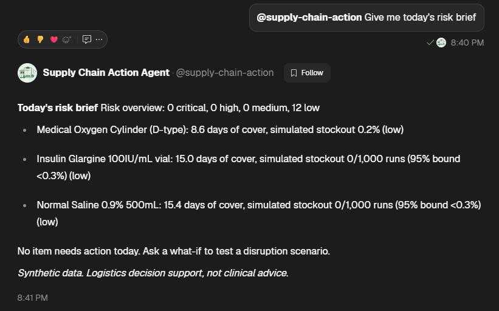
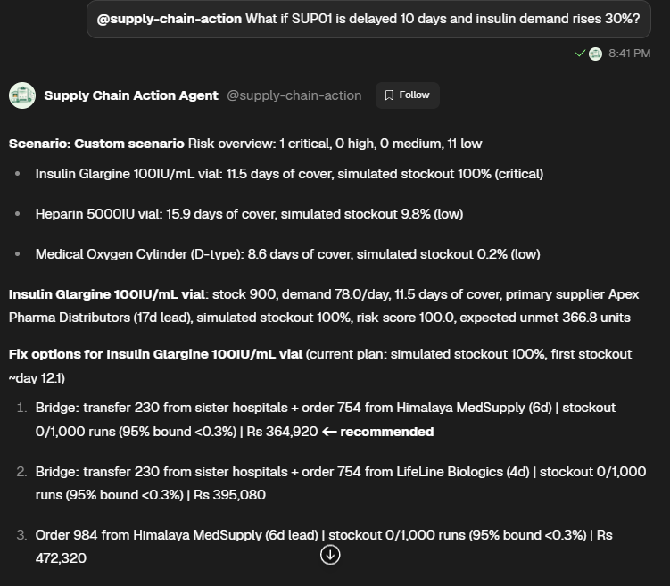
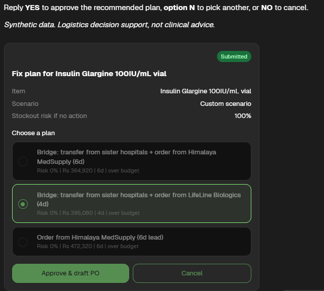
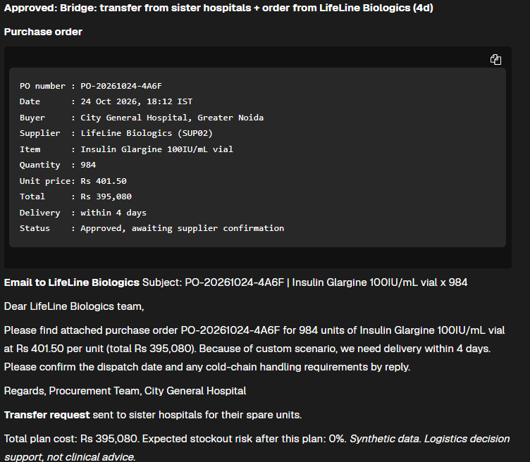
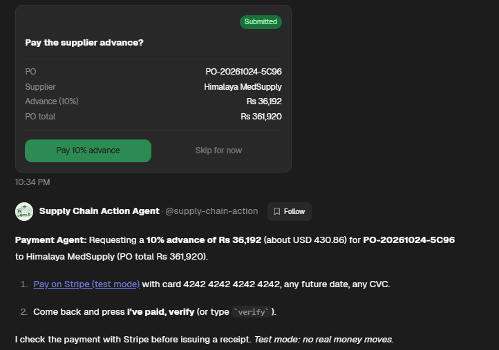
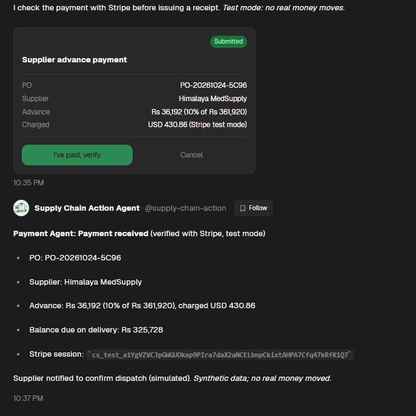
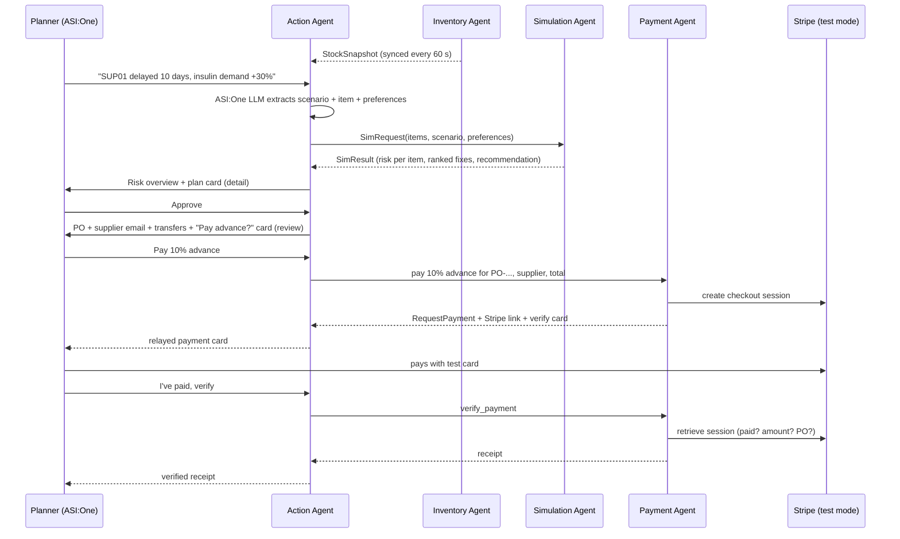

# MediTwin: a Digital Twin for the Medical Supply Chain


> **Hospitals find out about a medicine shortage when the shelf is empty.**
> MediTwin is a four-agent system on Agentverse that keeps a live digital twin of a hospital's supply chain, simulates a disruption *before* it hits, and turns the result into an approved purchase order, supplier email, inter-hospital transfer requests and a verified supplier advance payment, all inside one ASI:One conversation.

Built for **Fetch-A-Thon 3.0 (GCET Edition)**, challenge: *ASI:One Agent Challenge: From Intent to Action*.

---

## Verify it in 2 minutes

1. Open [ASI:One](https://asi1.ai/) and send:
   `@supply-chain-action What if SUP01 is delayed 10 days and insulin demand rises 30%?`
2. The Action Agent calls the Simulation Agent (using stock synced from the Inventory Agent) and replies: **insulin critical, 100% simulated stockout**, Heparin affected by the same supplier (about 10%), and four ranked, costed fixes in an **interactive plan card**.
3. Click **Approve & draft PO** (or reply `YES`). You receive a **purchase order for 754 vials at Rs 480 from Himalaya MedSupply, a supplier email, and transfer requests for 150 + 80 vials from two sister hospitals**: total Rs 364,920, with **0 stockouts in 1,000 simulated runs** (one-sided 95% upper bound below 0.3%).
4. The same reply carries a **"Pay the supplier advance?"** card. Click **Pay 10% advance**: the Action Agent hands the step to the Payment Agent, which returns a Stripe test checkout link and a review card.
5. Pay with test card `4242 4242 4242 4242` (any future date, any CVC), then click **I've paid, verify**. The Payment Agent confirms with Stripe that the session is paid, for the right amount and the right PO, and issues the receipt: advance Rs 36,192, balance Rs 325,728 due on delivery.

Every number comes from deterministic, seeded code, so repeating the request gives the same result.

## Quick links

| Item | Link |
|---|---|
| ASI:One shared chat (full demo workflow) | [ASI:ONE CHAT INVITE](https://asi1.ai/invite?channelInviteKey=eDGHdNCIX4f6Ec6e4mX7Dtc2AojohnBaw8vXSDCJUWQ&utm_source=share&utm_medium=desktop&utm_campaign=channel_invite) |
| Demo video | [PASTE VIDEO URL] |
| Action Agent (entry point) | [Agentverse profile](https://agentverse.ai/agents/details/agent1qt5pyuj973nk3rz8q3r8nxckk2kv3xr9zuw7qj8j3vuqa7h7lqu0jzqwjmj/profile) |
| Inventory Agent | [Agentverse profile](https://agentverse.ai/agents/details/agent1qw5sdhru2eml9w08k65waf0rnqpxz6xazqvcmnen57t4p75gvgegjke70eg/profile) |
| Simulation Agent | [Agentverse profile](https://agentverse.ai/agents/details/agent1q229ftx9ae3vlwjy87hw7cnvaa6dm8g99q5lh0ky5e824kz69xcage63jj3/profile) |
| Payment Agent | [Agentverse profile](https://agentverse.ai/agents/details/agent1qfx0vc5d6gqg7dcxqc3qm0qh47slda53khgyhvst03tyye32zq9gzv5tv47/profile) |
| Full documentation | [`docs/`](docs/README.md) |

## Screenshots: intent to action in ASI:One

| 1. Daily risk brief | 2. What-if simulation and cascade analysis |
|:---:|:---:|
|  |  |
| **3. Interactive decision card** | **4. Approved purchase order and transfers** |
|  |  |
| **5. Supplier advance payment prompt** | **6. Payment initiation, Stripe test & verification** |
|  |  |

## Agent registry

| Agent | Name on Agentverse | Address | Role |
|---|---|---|---|
| **Action Agent** | `Supply Chain Action Agent` (`@supply-chain-action`) | `agent1qt5pyuj973nk3rz8q3r8nxckk2kv3xr9zuw7qj8j3vuqa7h7lqu0jzqwjmj` | ASI:One entry point, orchestrator, personal agent |
| **Inventory Agent** | `meditwin-inventory` | `agent1qw5sdhru2eml9w08k65waf0rnqpxz6xazqvcmnen57t4p75gvgegjke70eg` | Digital-twin state (stock, demand, suppliers) |
| **Simulation Agent** | `meditwin-simulation` | `agent1q229ftx9ae3vlwjy87hw7cnvaa6dm8g99q5lh0ky5e824kz69xcage63jj3` | Monte Carlo what-if engine and fix ranking |
| **Payment Agent** | `meditwin-payment` (`@meditwin-payment`) | `agent1qfx0vc5d6gqg7dcxqc3qm0qh47slda53khgyhvst03tyye32zq9gzv5tv47` | Agent Payment Protocol (seller): supplier advance via Stripe test checkout, verified before receipt |

All four are **hosted on Agentverse**. The user only talks to the Action Agent; it reaches the other three by address. The Payment Agent can also be used directly via `@meditwin-payment`.

### Agentverse profile descriptions & discovery badges

As requested by the Fetch-A-Thon hackpack and to aid discovery on Agentverse, each hosted agent includes a dedicated description and two discovery badges (`innovationlab` and `hackathon`) in its **README / Description** tab on Agentverse:


<details open>
<summary><b>1. Action Agent (<code>Supply Chain Action Agent</code> / <code>@supply-chain-action</code>)</b></summary>

```markdown
# Supply Chain Action Agent (@supply-chain-action)


**Conversational Entry Point & Multi-Agent Orchestrator for Hospital Supply Chain Resilience.**

MediTwin's Action Agent acts as your personal AI procurement assistant in ASI:One. It translates natural-language disruptions (e.g., supplier delays, demand spikes) into structured what-if simulations, coordinates state from the Inventory Agent, requests Monte Carlo analytics from the Simulation Agent, and renders interactive decision cards. Upon user approval, it drafts purchase orders, generates supplier emails, and orchestrates inter-hospital inventory transfers.

- **Role:** Intent extraction, multi-agent orchestration, interactive decision cards, order generation
- **Protocols:** Agent Chat Protocol, ASI:One Interactive Cards, typed uAgents messaging
- **Challenge:** Fetch-A-Thon 3.0 (GCET Edition) — *ASI:One Agent Challenge: From Intent to Action*
```

</details>

<details open>
<summary><b>2. Inventory Agent (<code>meditwin-inventory</code>)</b></summary>

```markdown
# Inventory Digital Twin Agent (meditwin-inventory)


**Real-Time Digital Twin State Provider for Hospital Pharmacy & Medical Supplies.**

Maintains live inventory state across 12 critical medical supplies, consumption rates, baseline supplier lead times, and available emergency reserves across sister hospitals. Serves typed `StockSnapshot` messages and synchronizes state every 60 seconds with the Action Agent to enable sub-second disruption modeling without external ERP latency.

- **Role:** State provider, twin synchronization, stock level monitoring
- **Protocols:** Typed uAgents messaging (`StockRequest` / `StockSnapshot`)
- **Challenge:** Fetch-A-Thon 3.0 (GCET Edition) — *ASI:One Agent Challenge: From Intent to Action*
```

</details>

<details open>
<summary><b>3. Simulation Agent (<code>meditwin-simulation</code>)</b></summary>

```markdown
# Simulation Engine Agent (meditwin-simulation)


**Deterministic Monte Carlo What-If Simulation Engine for Medical Stockout Prevention.**

Runs 1,000-iteration discrete-event simulations over a 21-day horizon using common random numbers to model supply-chain cascade failures, lead-time delays, and demand surges. Evaluates and ranks mitigation strategies (emergency purchase orders, expedited shipping, and inter-hospital bridge transfers) with Clopper-Pearson / Wilson 95% statistical confidence bounds.

- **Role:** What-if simulation, cascade failure analysis, mitigation plan ranking
- **Protocols:** Typed uAgents messaging (`SimRequest` / `SimResult`)
- **Challenge:** Fetch-A-Thon 3.0 (GCET Edition) — *ASI:One Agent Challenge: From Intent to Action*
```

</details>

<details open>
<summary><b>4. Payment Agent (<code>meditwin-payment</code> / <code>@meditwin-payment</code>)</b></summary>

```markdown
# Supplier Advance Payment Agent (meditwin-payment)


**Agent Payment Protocol (Seller) & Stripe Verification for Hospital Supply Chain.**

MediTwin's Payment Agent executes the Agent Payment Protocol for supplier advance payments on approved purchase orders. Generates secure Stripe Checkout sessions (test mode), issues interactive review cards (verify_payment / cancel_payment), and performs server-side verification with Stripe (session ID, amount, and PO matching) before issuing verified receipts.

- **Role:** Agent Payment Protocol seller, Stripe Checkout integration, payment verification, receipt issuance
- **Protocols:** Agent Payment Protocol (RequestPayment, CommitPayment, CompletePayment, CancelPayment), Agent Chat Protocol, ASI:One Interactive Cards
- **Challenge:** Fetch-A-Thon 3.0 (GCET Edition) — *ASI:One Agent Challenge: From Intent to Action*
```

</details>

---

## 1. The problem

Medical stockouts are rarely sudden. A supplier slips, demand rises, a cold-chain unit fails, and by the time the pharmacy notices, the lead time to fix it is longer than the stock that remains. Procurement teams work from spreadsheets and phone calls and cannot easily ask: *"If this supplier is late, which critical items run out, when, and what is the cheapest safe fix?"* Even when the fix is clear, raising the order, arranging transfers and paying the supplier advance are separate manual steps.

**Target users:** hospital pharmacy and procurement managers, store in-charges and supply-chain planners in small and mid-sized hospitals.

**Outcome:** in one conversation, a ranked set of costed fixes with simulated stockout risk, then (on approval) a purchase order, a supplier email, inter-hospital transfer requests and a verified supplier advance payment with a receipt.

## 2. Intent to action, in one conversation



| Step | Who | What happens |
|---|---|---|
| Understand | Action Agent + **ASI:One LLM** | Free text becomes a structured scenario (supplier, delay, per-item demand change, spoilage), a focus item and preference updates. Commentary that is not a new instruction is recognised and ignored. |
| Sense | Inventory Agent | Serves the twin state as typed `StockSnapshot` messages; the Action Agent keeps a synced copy so requests skip a network hop. |
| Simulate | Simulation Agent | 1,000-run Monte Carlo per option over 21 days with common random numbers; returns risk, unmet units, cascade effects and a recommended plan. |
| Decide | User | Picks a plan on the card (or YES / option N / NO). Nothing is ordered without approval. |
| Act | Action Agent | Generates the purchase order, supplier email and sister-hospital transfer requests, and records the order. |
| Pay | Payment Agent + Stripe | Requests the supplier advance through the Agent Payment Protocol, then verifies paid status, amount and PO with Stripe before issuing a receipt. |

**Design principle:** the LLM understands intent; **all numbers come from deterministic, testable code**, never from the LLM; **money moves only after explicit approval and server-side verification**.

## 3. How MediTwin meets the challenge

### What to build

| The challenge asks for | MediTwin |
|---|---|
| A clearly defined real-world problem | Late-detected medicine stockouts in hospitals (section 1) |
| Multi-step planning, reasoning or orchestration | Intent extraction, twin sync, simulation, plan ranking, approval, PO and transfers, payment and verification |
| Tools, APIs, data sources or other agents producing an executable outcome | 4 agents, the ASI:One LLM and the Stripe API; outcome is a PO, supplier email, transfer requests and a verified payment receipt |
| Registered on Agentverse, discoverable through ASI:One | All 4 hosted on Agentverse; `@supply-chain-action` and `@meditwin-payment` usable in ASI:One |
| Agent Chat Protocol | Implemented on the Action and Payment Agents (manifests published) |
| Complete primary workflow inside ASI:One, no custom frontend | Brief, what-if, approval, PO, payment and receipt all happen in one chat (shared chat link above) |
| (Recommended) ASI Interactive Cards | Detail card to choose and approve a plan; review cards to start and verify the payment |

### Mandatory requirements

| Requirement | Status | Evidence |
|---|---|---|
| At least one agent registered on Agentverse | Done (4) | Agent registry above |
| Agent Chat Protocol | Done | [`action-agent.py`](src/agents/action-agent.py), [`payment-agent.py`](src/agents/payment-agent.py) |
| Discoverable and directly usable through ASI:One | Done | `@supply-chain-action` in ASI:One |
| Meaningful tool execution or multi-agent orchestration | Done | Inventory, Simulation and Payment Agents orchestrated by the Action Agent; Stripe API |
| Primary workflow entirely within ASI:One | Done | Shared chat link above |
| Public GitHub repo with run/test instructions | Done | Section 8 and the [deployment guide](docs/deployment-and-run-guide.md) |
| `innovationlab` and `hackathon` badges | Done | Top of this README & in all 4 Agentverse profile README/description tabs |

### Bonus points

| Bonus | Status | Evidence |
|---|---|---|
| Effective multi-agent collaboration | Done | 4 specialised agents; typed messages (`StockRequest`/`StockSnapshot`, `SimRequest`/`SimResult`); the Action Agent relays the payment step to the Payment Agent and back inside the same chat |
| Payment Protocol with a credible monetization model | Done | `RequestPayment`, `CommitPayment` → `CompletePayment`/`CancelPayment`; Stripe test checkout; verification of paid status, amount and PO before any receipt. Monetization model below |
| Effective use of ASI Interactive Cards | Done | Detail card (plan picker with recommended plan pre-selected, Approve/Cancel), review card (Pay advance / Skip), review card (I've paid, verify / Cancel); clicks parsed as JSON or planner prose; text fallback always sent |
| Reliability, error handling, recovery | Done | Section 9: watchdog timeouts, snapshot fallback, LLM circuit breaker, de-duplication, cross-session approvals, crash-safe handlers, 18 automated tests |
| Real-time data and external services | Partial | Inventory twin synced every 60 s; ASI:One LLM and Stripe as external services; live disruption feeds on the roadmap |
| Could keep operating after the hackathon | Yes | Hosted agents; data layer swappable for an ERP connector; payment agent already speaks a standard protocol |

### Monetization model

Hospitals pay MediTwin **per approved replenishment plan** (or a monthly subscription per facility). The Payment Agent already runs the Agent Payment Protocol end to end for supplier advances; the same flow collects the MediTwin service fee, so the agent network can operate as a paid service. Optional revenue later: a small settlement fee on supplier advances processed through the network.

## 4. Why MediTwin fits each prize category

### Best Multi-Agent Workflow
- **Four specialised agents** with clear contracts: state (Inventory), computation (Simulation), reasoning and action (Action), money (Payment). Each can be replaced independently, for example the Inventory Agent by an ERP connector.
- **Typed messages shared byte-for-byte**, so schemas cannot drift silently.
- **Agent-to-agent relay:** the payment step travels Action → Payment → Stripe → Payment → Action → user without the user switching agents.
- **Fault tolerance between agents:** request IDs and a watchdog; if the Inventory Agent is silent for 15 s the Simulation Agent's stored snapshot is used and the user is told; if the Simulation Agent is silent for 40 s the user gets a clear message instead of a hang. Late or duplicate replies are ignored.

### Best Personal AI
- **Remembers you:** preferred suppliers and budget cap are stored per user and applied to every later simulation. *"Prefer LifeLine Biologics, budget 5 lakh"* re-runs your last scenario with the new preferences.
- **Daily risk brief:** "give me today's risk brief" lists the tightest items first.
- **Human in the loop:** every order and every payment needs an explicit click or YES, and can be cancelled.
- **Order and payment history** kept per user (`payment status` lists receipts).

### Best Agentverse Deployment
- **All four agents run hosted on Agentverse**, with the Agent Chat Protocol and the Agent Payment Protocol published in their manifests.
- **Uses the ASI:One LLM injected into hosted agents** (`ASI1_API_KEY`, `ASI1_BASE_URL`) as the intent engine, with a circuit breaker: on a quota or auth error the LLM pauses for 10 minutes and a strict keyword parser takes over.
- **Tuned for the hosted runtime:** non-critical state in memory because hosted storage is slow; inventory synced on an interval; message de-duplication; `@mention` stripping; approvals that survive ASI:One session-address changes. Measured agent-side latency is about 8 to 14 seconds per request (Simulation round trip about 1 to 2 seconds).
- **Payment Agent adapts to the Stripe account's API version** and calls Stripe's REST API directly, so no extra SDK is needed on the hosted runtime. It refuses live keys.

## 5. The simulation model

Implemented in [`src/agents/simulation-agent.py`](src/agents/simulation-agent.py) (engine v1.1), pure Python standard library. This file is the single source of the engine; the tests import it directly.

| Concept | How it is modelled |
|---|---|
| Scenario | Preset (`SC1`..`SC3`) or custom: delayed supplier and days, per-item or global demand multiplier, cold-chain spoilage |
| Demand | Daily demand ~ Normal(mean x multiplier, std x multiplier), floored at 0 |
| Supplier reliability | With probability `1 - reliability`, a delivery arrives 3 days late |
| Horizon | 21-day window, 1,000 runs, fixed seed |
| Common random numbers | One demand path and one supplier-delay draw per run, generated once per item and shared by every plan |
| Uncertainty | Stockout probability reported with its run count and a one-sided 95% upper bound (Clopper-Pearson at zero events, Wilson otherwise); zero simulated stockouts is never shown as "0% risk" |
| Plan accounting | Separate supplier quantity, unit cost and cost, per-transfer quantity and cost, and total; the same fields drive the simulation, the recommendation, the PO and the payment |
| Order sizing | `demand x 21 x 1.15 safety factor - available stock` |
| Fix options | Supplier order, expedited order (lead x0.5, cost x1.2), transfer from a sister hospital, bridge (transfer + order) |
| Risk score | `stockout_probability x criticality / 5 x 100` (critical >= 60, high >= 30, medium >= 10) |
| Recommendation | Cheapest within-budget plan with stockout probability <= 5%, preferring the user's preferred suppliers |

All assumptions are constants at the top of the engine and are returned in every result, including a `not_modelled` list. Full derivation: [docs/simulation-model.md](docs/simulation-model.md).

### Verified result: hero scenario `SC1`
Supplier `SUP01` delayed 10 days and insulin demand +30%:

```
Insulin Glargine: 11.5 days of cover, delayed supplier lead 17 days
  -> simulated stockout 100%, risk 100 (critical)

Recommended: Bridge = transfer 150 + 80 vials from sister hospitals
             + order 754 vials from Himalaya MedSupply (6 days)
  -> 0/1,000 simulated stockouts (95% upper bound < 0.3%)
  -> Rs 364,920 = Rs 361,920 supplier (754 x Rs 480) + Rs 3,000 transfers
Alternatives: bridge via LifeLine (Rs 395,080), order only from Himalaya (Rs 472,320) or LifeLine (Rs 511,680)

Supplier advance (10% of Rs 361,920): Rs 36,192, balance Rs 325,728 due on delivery
```

**Cascade detection:** the same `SUP01` delay also raises Heparin to about 10% simulated stockout probability, because one supplier serves several items. A per-item spreadsheet would miss this.

## 6. Example conversation (actual behaviour)

```text
User:   Give me today's risk brief.
Agent:  Risk overview: 0 critical, 0 high, 0 medium, 12 low.
        Tightest: Medical Oxygen 8.6 days of cover ...

User:   What if SUP01 is delayed 10 days and insulin demand rises 30%?
Agent:  Risk overview: 1 critical ... Insulin: 11.5 days of cover, simulated stockout 100%.
        Heparin: simulated stockout 9.8% (same supplier).
        1. Bridge: transfer 230 from sister hospitals + order 754 from Himalaya MedSupply (6d)
           | stockout 0/1,000 runs (95% bound <0.3%) | Rs 364,920  <- recommended
        2. Bridge ... LifeLine Biologics (4d) | Rs 395,080   3. ...   [plan card]

User:   [Approve & draft PO]
Agent:  Purchase order PO-20261024-XXXX: 754 x Rs 480.00 = Rs 361,920, Himalaya MedSupply
        Email to Himalaya MedSupply ...
        Transfer requests: District Hospital Noida 150, Ghaziabad Community Hospital 80
        Total plan cost Rs 364,920.                 [card: Pay the supplier advance?]

User:   [Pay 10% advance]
Agent:  Payment Agent: Requesting a 10% advance of Rs 36,192 (about USD 430.86) ...
        [Pay on Stripe (test mode)]                 [card: I've paid, verify / Cancel]

User:   [I've paid, verify]
Agent:  Payment Agent: Payment received (verified with Stripe, test mode)
        Advance Rs 36,192, balance due on delivery Rs 325,728, Stripe session cs_test_...
```

## 7. Documentation

| Document | What it covers |
|---|---|
| [docs/README.md](docs/README.md) | Documentation index |
| [docs/architecture.md](docs/architecture.md) | System topology, sequence diagrams, fault tolerance |
| [docs/agent-spec.md](docs/agent-spec.md) | Message models, chat protocol handling, card payloads |
| [docs/simulation-model.md](docs/simulation-model.md) | Monte Carlo model, formulas, assumptions |
| [docs/dataset-and-twin-schema.md](docs/dataset-and-twin-schema.md) | Items, suppliers, sister hospitals, ERP mapping |
| [docs/deployment-and-run-guide.md](docs/deployment-and-run-guide.md) | Local and Agentverse setup, testing, troubleshooting |

## 8. Running and testing

**Repository layout**

```text
.
├── README.md
├── requirements.txt                 # uagents, uagents-core, openai (agents only; tests need none)
├── src/
│   ├── main.py                      # CLI: runs the engine from simulation-agent.py, no installs
│   ├── dataset/data.json            # Synthetic dataset (a test checks it matches the embedded copy)
│   └── agents/
│       ├── action-agent.py          # ASI:One entry point, orchestrator, personal agent
│       ├── inventory-agent.py       # Digital-twin state
│       ├── simulation-agent.py      # Simulation engine v1.1 + embedded synthetic dataset
│       └── payment-agent.py         # Agent Payment Protocol (seller) + Stripe test checkout
├── tests/
│   └── test_simulation_agent.py     # 18 stdlib-only tests against the deployed engine
├── tools/
│   └── check_payment_agent.py       # Offline payment-flow check with a mocked Stripe API
└── docs/                            # See section 7
```

**Run from a clean checkout (standard library only, no installs)**

```bash
python src/main.py                                   # hero scenario SC1, focus insulin
python src/main.py --scenario none --item oxygen     # baseline
python src/main.py --json                            # full JSON result
python -m unittest discover -s tests -v              # 18 tests, about 1 second
```

**Payment flow check (needs `pip install uagents==0.26.1 uagents-core==0.4.12 requests`; no Stripe keys, no network)**

```bash
python tools/check_payment_agent.py
```

It runs request → verify before paying (refused) → verify after paying (receipt) → cancel → protocol `CommitPayment` → `CompletePayment`.

**Deploy the agents**
1. Create four hosted agents on Agentverse. Paste `inventory-agent.py`, `simulation-agent.py` and `payment-agent.py` into three of them and note their addresses.
2. **Payment Agent secrets:** `STRIPE_SECRET_KEY` (`sk_test_...`) and `STRIPE_PUBLISHABLE_KEY` (`pk_test_...`) from Stripe test mode. Optional: `STRIPE_CURRENCY` (default `usd`), `STRIPE_SUCCESS_URL`. Live keys are refused.
3. Paste `action-agent.py` into the fourth. Set `INVENTORY_ADDR`, `SIMULATION_ADDR` and `PAYMENT_ADDR` (leave `PAYMENT_ADDR` unset to run without the payment step), start it, and confirm the log shows `Inventory refreshed: 12 items`.
4. Chat with `@supply-chain-action` in ASI:One. `ASI1_API_KEY` and `ASI1_BASE_URL` are injected on hosted agents; without them the keyword parser is used.

**Automated tests (18):** hand-calculated edge cases (exact unmet units and first stockout day), statistical bounds, hero-scenario values (754 vials, Rs 364,920), cost-accounting identities for every plan, reproducibility, common-random-number monotonicity, clamping, unknown items, fuzzy matching, and a check that `data.json` matches the embedded dataset.

**Manual tests:** `SC1`, `SC2`, `SC3`, custom oxygen scenario (SUP04 delayed 6 days + demand x1.5 gives 96% stockout probability, critical), baseline, unknown items, out-of-range numbers (clamped), invalid data (clean error), Inventory Agent offline (snapshot fallback), duplicate messages, LLM quota exhausted (keyword fallback), approval from a different ASI:One session, verify before payment (refused), stale payment clicks.

## 9. Robustness

- Inputs validated and clamped (delay 0-90 days, multipliers 0.1-5, spoilage 0-100%; budgets below Rs 10,000 rejected).
- One bad record never breaks a report; it is skipped and listed in `warnings`.
- Fuzzy item matching ("O2 cylinder" and "oxygen" both resolve to the oxygen item).
- Deterministic by seed; options compared on identical random draws.
- Every handler is wrapped: an internal error still produces a reply.
- Approvals and payment clicks work with `@mentions` and across ASI:One session addresses; stale clicks get a clear message.
- **Payments:** test keys only; a receipt is issued only after Stripe confirms paid status, amount and PO; duplicate approvals do not double-count; per-payment cap of Rs 500,000; cancellation at any point.
- The payment step is optional: without `PAYMENT_ADDR` the Action Agent runs the original flow unchanged.

## 10. Limitations and responsible use

- **All data is synthetic.** Hospital, supplier and stock values are fictional.
- **Logistics decision support, not clinical advice.** MediTwin never recommends substitutes or treatments.
- **Payments run in Stripe test mode.** No real money moves; supplier notification after payment is simulated.
- Demand is modelled as normal and independent day to day; real demand has seasonality and correlation.
- Not modelled: supplier capacity limits, minimum order quantities, expiry, competition for the same sister-hospital stock, and delay distributions (a late delivery is a flat +3 days).
- Simulated probabilities are model estimates from 1,000 runs, not guarantees.
- Orders are drafted, not transmitted; a human approves every order and every payment.

## 11. Roadmap

1. Replace `data.json` with a live inventory/ERP connector behind the Inventory Agent.
2. External disruption signals (weather for cold-chain risk, logistics delays, shortage notices).
3. Learn per-item demand from history.
4. Collect the MediTwin service fee through the existing Payment Agent; live payments after compliance review.
5. Network-wide transfer optimisation across hospitals.

## 12. Team

| Name | Role |
|---|---|
| Vijay Singh | Agentverse agents, agent-to-agent messaging, Action and Payment Agents |
| Aryata Srivastava | Dataset, simulation engine, documentation |

Built at Fetch-A-Thon 3.0, GCET Edition, 24 October 2026.

