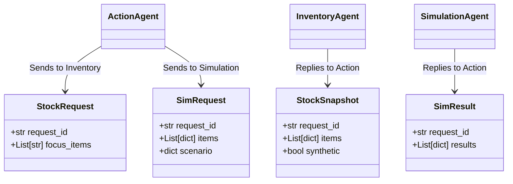

# MediTwin Agent Specification & Protocol Reference

> **Standards Compliance**: Fetch.ai `uagents` (v0.26+), `uagents-core` (v0.4+), Agent Chat Protocol (`chat_protocol_spec`), Agentverse Interactive Card Protocol v1.

---

## 1. Agent Registry & Network Identifiers

| Agent Name | Role | Source File | Agentverse Testnet Address | Chat Handle | Discovery Status |
|---|---|---|---|---|---|
| **Action Agent** | Front door, orchestrator, conversational UI | [`src/agents/action-agent.py`](file:///c:/Users/sriva/OneDrive/Documents/projects/DevPair/fetch-a-thon/src/agents/action-agent.py) | `agent1qt5pyuj973nk3rz8q3r8nxckk2kv3xr9zuw7qj8j3vuqa7h7lqu0jzqwjmj` | `@supply-chain-action` | **Public** (ASI:One Searchable) |
| **Inventory Agent** | Digital twin stock state provider | [`src/agents/inventory-agent.py`](file:///c:/Users/sriva/OneDrive/Documents/projects/DevPair/fetch-a-thon/src/agents/inventory-agent.py) | `agent1qw5sdhru2eml9w08k65waf0rnqpxz6xazqvcmnen57t4p75gvgegjke70eg` | `@meditwin-inventory` | Internal |
| **Simulation Agent** | Discrete-event Monte Carlo what-if engine | [`src/agents/simulation-agent.py`](file:///c:/Users/sriva/OneDrive/Documents/projects/DevPair/fetch-a-thon/src/agents/simulation-agent.py) | `agent1q229ftx9ae3vlwjy87hw7cnvaa6dm8g99q5lh0ky5e824kz69xcage63jj3` | `@meditwin-simulation` | Internal |

---

## 2. Protocols Implemented

### 2.1. Agent Chat Protocol (`chat_protocol_spec`)
The Action Agent implements the standard Fetch.ai Agent Chat Protocol defined in `uagents_core.contrib.protocols.chat`. This allows ASI:One (and any compatible chat client) to exchange bidirectional messages with the agent.

```
Agentverse / ASI:One Client                              Action Agent
            │                                                 │
            │──────────── ChatMessage(text, msg_id) ─────────>│
            │<─────────── ChatAcknowledgement(msg_id) ────────│
            │                                                 │
            │            [Orchestrates Twin & Simulation]     │
            │                                                 │
            │<─── ChatMessage(TextContent + MetadataContent) ─│
            │     (or TextContent + EndSessionContent)        │
```

#### Message Schemas:
```python
class TextContent(Model):
    type: str = "text"
    text: str

class MetadataContent(Model):
    type: str = "metadata"
    metadata: dict[str, str]

class EndSessionContent(Model):
    type: str = "end-session"

class ChatMessage(Model):
    timestamp: datetime
    msg_id: UUID
    content: list[TextContent | MetadataContent | EndSessionContent]

class ChatAcknowledgement(Model):
    timestamp: datetime
    acknowledged_msg_id: UUID
```

---

## 3. Internal Agent-to-Agent Messaging Schemas

All inter-agent communication between the Action, Inventory, and Simulation agents uses typed Pydantic models derived from `uagents.Model`.



### 3.1. `StockRequest`
Sent by the Action Agent to the Inventory Agent to retrieve the hospital's live stock snapshot.

```python
class StockRequest(Model):
    request_id: str             # Unique correlation ID (e.g., 8-char hex)
    focus_items: List[str] = [] # Optional item IDs/names to filter (empty = full catalog)
```

### 3.2. `StockSnapshot`
Returned by the Inventory Agent containing live items and metadata.

```python
class StockSnapshot(Model):
    request_id: str             # Matching correlation ID
    items: List[dict]           # Array of item dictionaries (schema detailed in dataset docs)
    synthetic: bool = True      # Flag indicating synthetic benchmark data
```

### 3.3. `SimRequest`
Sent by the Action Agent to the Simulation Agent to run Monte Carlo analysis.

```python
class SimRequest(Model):
    request_id: str             # Matching correlation ID
    items: List[dict]           # Digital twin items from Inventory Agent
    scenario: dict              # Scenario parameters + optional focus item + preferences
```

#### Scenario Dictionary Format:
```json
{
  "supplier_id": "SUP01",
  "delay_days": 10,
  "demand_multiplier": {"I01": 1.3},
  "spoilage_pct": 0.0,
  "item": "insulin",
  "preferences": {
    "preferred_suppliers": ["SUP02"],
    "budget_cap_inr": 600000
  }
}
```

### 3.4. `SimResult`
Returned by the Simulation Agent to the Action Agent.

```python
class SimResult(Model):
    request_id: str             # Matching correlation ID
    results: List[dict]         # List of analyzed items followed by a {"meta": {...}} object
```

#### Per-Item Result Schema:
```json
{
  "item_id": "I01",
  "item": "Insulin Glargine 100IU/mL vial",
  "criticality": 5,
  "stock_now": 900,
  "daily_demand": 78.0,
  "days_of_cover": 11.5,
  "primary_supplier": "SUP01",
  "primary_lead_days": 17,
  "primary_base_lead_days": 7,
  "shortfall_days": 5.5,
  "stockout_prob": 1.0,
  "expected_unmet_units": 452.3,
  "expected_first_stockout_day": 12.1,
  "risk_score": 100.0,
  "severity": "critical",
  "options": [
    {
      "id": "bridge_SUP03",
      "type": "bridge",
      "label": "Bridge: transfer from sister hospitals + order from Himalaya MedSupply (6d)",
      "supplier_id": "SUP03",
      "qty": 834,
      "lead_days": 6,
      "total_cost_inr": 364920,
      "within_budget": true,
      "preferred": false,
      "stockout_prob": 0.0,
      "expected_unmet_units": 0.0
    }
  ],
  "recommended": "bridge_SUP03",
  "recommendation_reason": "Lowest-cost plan keeping stockout risk <= 5%"
}
```

---

## 4. Agentverse Interactive Card Specification

When rendering a recommendation with pending actions, the Action Agent packs an Interactive Card inside the `MetadataContent` block of the chat message.

```json
{
  "card_protocol_version": "1",
  "requires_card_interaction": "true",
  "card_kind": "detail",
  "preferred_drawer_width_px": "540",
  "card_payload": "{\"title\": \"Fix plan for Insulin Glargine 100IU/mL vial\", ...}"
}
```

### Decoded `card_payload` Structure:
```json
{
  "title": "Fix plan for Insulin Glargine 100IU/mL vial",
  "summary_rows": [
    {"label": "Item", "value": "Insulin Glargine 100IU/mL vial"},
    {"label": "Scenario", "value": "Supplier delay + insulin demand surge"},
    {"label": "Stockout risk if no action", "value": "100%"},
    {"label": "Recommended", "value": "Bridge: transfer + Himalaya MedSupply (Rs 364,920)"}
  ],
  "sub_options": {
    "name": "plan_id",
    "kind": "radio",
    "label": "Choose a plan",
    "choices": [
      {
        "value": "bridge_SUP03",
        "label": "Recommended: Bridge: transfer + Himalaya MedSupply (6d)",
        "secondary_text": "Risk 0% | Rs 364,920 | 6d"
      },
      {
        "value": "order_SUP03",
        "label": "Order from Himalaya MedSupply (6d lead)",
        "secondary_text": "Risk 0% | Rs 472,320 | 6d"
      }
    ]
  },
  "ctas": [
    {
      "label": "Approve & draft PO",
      "selection": {"action": "approve_plan"},
      "primary": true
    },
    {
      "label": "Cancel",
      "selection": {"action": "cancel_plan"}
    }
  ]
}
```

### Dual-Channel Interaction Parsing:
1. **Interactive UI Click**: ASI:One sends back the selection JSON payload:
   `{"action": "approve_plan", "plan_id": "bridge_SUP03"}`
2. **Text Fallback**: If the user replies via regular text (`YES`, `Option 1`, `No`, `Cancel`), the Action Agent's regex parser reconciles the text against the pending options in storage.

---

## 5. Storage & Persistence Model

The Action Agent utilizes Agentverse storage (`ctx.storage`) for durable state and an in-memory dictionary (`MEM`) for transient, high-speed access:

| Key Pattern | Storage Location | Data Type | Purpose | TTL / Expiry |
|---|---|---|---|---|
| `prefs_<sender>` | `ctx.storage` | `dict` | Remembered user preferences (`preferred_suppliers`, `budget_cap_inr`) | Persistent |
| `pending_<sender>` | `ctx.storage` | `dict` | Current unapproved plan options awaiting user confirmation | Cleared on Approve/Cancel |
| `orders_<sender>` | `ctx.storage` | `list[dict]` | Rolling log of last 10 approved purchase orders | Persistent |
| `last_<sender>` | `ctx.storage` | `dict` | Last executed scenario and focus item (enables re-runs upon setting preferences) | Overwritten on each run |
| `open_rids` | `ctx.storage` | `list[str]` | Pool of currently active correlation IDs being monitored by the watchdog | Cleared on response/timeout |
| `req_<rid>` | `ctx.storage` | `dict` | Execution metadata for in-flight request (user, stage, timestamp, notes) | Cleared on completion |
| `inv_cache` | `MEM` (RAM) | `dict` | Cached digital twin stock items synced from Inventory Agent | 300 seconds |
| `llm_off_until` | `MEM` (RAM) | `float` | Epoch timestamp until which LLM API calls are suppressed (circuit breaker) | 600 seconds on error |
| `seen` | `MEM` (RAM) | `list[str]` | Message ID deduplication ring buffer (last 200 message IDs) | In-memory |

---

## 6. Event Handlers & Background Tasks

### Action Agent:
- `@agent.on_event("startup")`: Bootstraps inventory synchronization (`request_id="sync"`).
- `@agent.on_interval(period=60.0)` (`sync_inventory`): Background polling job maintaining a warm inventory cache in RAM.
- `@agent.on_interval(period=5.0)` (`watchdog`): Health monitor verifying open requests against `INV_TIMEOUT` (15s) and `SIM_TIMEOUT` (40s).
- `@chat_proto.on_message(ChatMessage)`: Ingests user input, dispatches ack, and runs intent processing.
- `@agent.on_message(StockSnapshot)`: Ingests inventory snapshots, writes to cache, and forwards to Simulation Agent.
- `@agent.on_message(SimResult)`: Ingests simulation results, generates UI card/text, sets pending approval state, and responds to user.

### Inventory Agent:
- `@agent.on_event("startup")`: Initializes and logs item catalog status.
- `@agent.on_message(StockRequest)`: Filters catalog and returns `StockSnapshot`.

### Simulation Agent:
- `@agent.on_event("startup")`: Verifies embedded dataset readiness.
- `@agent.on_message(SimRequest)`: Ingests stock, validates schema, runs Monte Carlo, and responds with `SimResult`.
