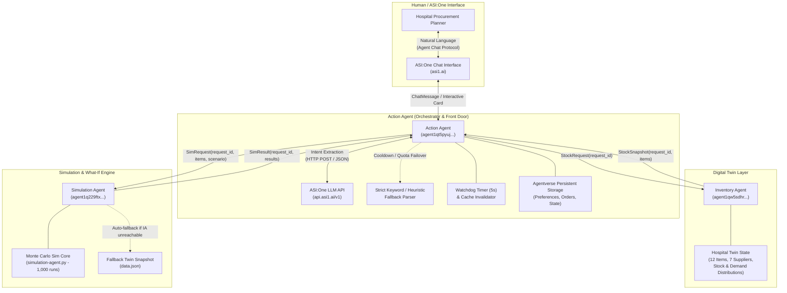
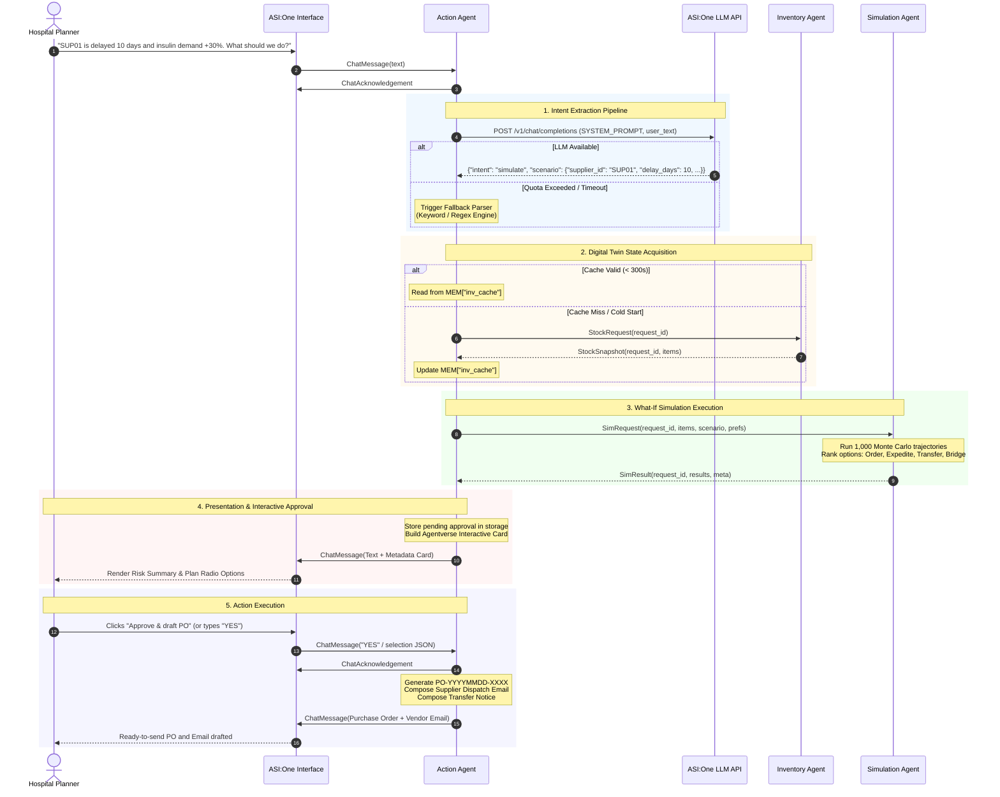
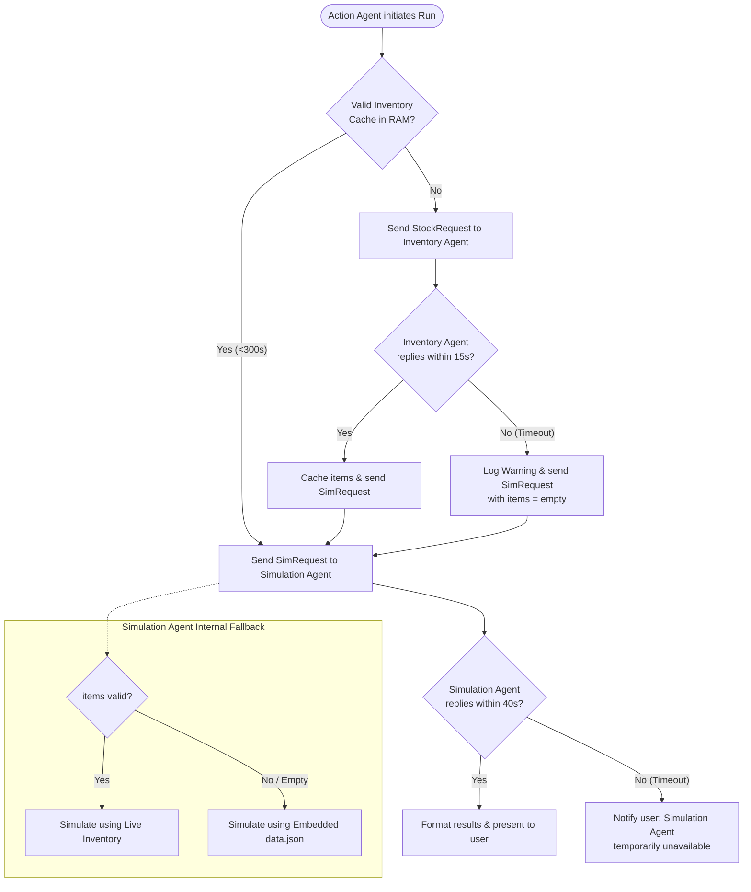

# MediTwin Architecture Specification

> **MediTwin: a Digital Twin for the Medical Supply Chain**  
> *Built for Fetch-A-Thon 3.0 (GCET Edition) — Challenge: ASI:One Agent Challenge: From Intent to Action*

---

## 1. Executive Summary

MediTwin is an autonomous, multi-agent digital twin system built on the **Fetch.ai `uagents` framework** and integrated with **ASI:One**. It transforms natural-language operational disruption alerts (e.g., supplier delays, regional demand surges, cold-chain temperature breaches) into deterministic risk assessments and actionable procurement resolutions without human spreadsheet wrangling.

### Core Architectural Tenet: Separation of Concerns
```
      Natural Language Intent                 Deterministic Execution
   ┌───────────────────────────┐           ┌───────────────────────────┐
   │    ASI:One & Action Agent │           │ Inventory & Simulation    │
   │  • Intent extraction      │ ────────> │  • Discrete digital twin  │
   │  • Dialogue orchestration │           │  • Monte Carlo simulation │
   │  • User preference memory │ <──────── │  • Zero LLM hallucination │
   │  • PO / Email formulation │           │  • 100% reproducible math │
   └───────────────────────────┘           └───────────────────────────┘
```
All quantitative analyses—stockout probabilities, shortfall timelines, days of cover, and cost calculations—are executed by deterministic, pure-Python algorithms. LLMs are strictly confined to natural language comprehension, preference parsing, and explanatory synthesis.

---

## 2. High-Level System Architecture

MediTwin consists of three specialized agents operating asynchronously over the **Fetch.ai Agent Network** via the **Agent Chat Protocol** and typed Pydantic messaging schemas.



---

## 3. Agent Topology & Responsibilities

| Agent | Module | Primary Role | Discoverable in ASI:One | Core State / Dependencies |
|---|---|---|---|---|
| **Action Agent** | [`action-agent.py`](../src/agents/action-agent.py) | Front door, dialogue state machine, intent parser, PO generator | **Yes** (User-facing) | Session storage, open request pool, LLM fallback circuit |
| **Inventory Agent** | [`inventory-agent.py`](../src/agents/inventory-agent.py) | Digital twin source of truth (stock, demand, lead times) | No (Internal) | In-memory catalog (12 items, 7 suppliers) |
| **Simulation Agent** | [`simulation-agent.py`](../src/agents/simulation-agent.py) | Wrapped Monte Carlo engine; what-if scenario evaluator | No (Internal) | Embedded baseline snapshot, simulation core |

### 3.1. Action Agent (`action-agent.py`)
The Action Agent acts as the orchestrator and personal assistant for the procurement officer:
- **Protocol Compliance**: Exposes the Fetch.ai Agent Chat Protocol (`chat_protocol_spec`), processing incoming `ChatMessage` payloads and emitting `ChatAcknowledgement`.
- **Hybrid Intent Extraction**:
  1. Primary: Calls the ASI:One LLM API (`https://api.asi1.ai/v1`) using a strictly constrained JSON-only system prompt.
  2. Failover: Automatically activates a deterministic keyword/regex heuristic parser if the LLM endpoint returns HTTP 401/403 (quota exceeded), timeouts (>8s), or connection errors. Engages a 600-second cooldown timer to prevent chat lag.
- **State Machine & Memory**:
  - Manages conversational history and pending approvals (`pending_<sender>`).
  - Stores user preferences (`prefs_<sender>`), such as supplier preferences and budget caps (in INR), persisting them between messages.
  - Logs approved Purchase Orders (`orders_<sender>`).
- **Synchronized Inventory Caching**:
  - Automatically queries the Inventory Agent every 60 seconds (`SYNC_PERIOD = 60.0s`).
  - Caches the snapshot in memory (`CACHE_MAX_AGE = 300s`) so incoming simulation requests can immediately route to the Simulation Agent, saving a round-trip network hop.
- **Action Synthesis**: Formats risk tables, generates interactive UI cards (Agentverse Metadata Protocol), drafts formal purchase orders with unique IDs (`PO-YYYYMMDD-XXXX`), and composes ready-to-dispatch vendor emails.

### 3.2. Inventory Agent (`inventory-agent.py`)
The Inventory Agent acts as the digital twin of City General Hospital's pharmacy and medical stores:
- **Data Catalog**: Maintains 12 critical medicines, fluids, and surgical supplies with mean daily consumption, standard deviation, current warehouse stock, reorder levels, cold-chain requirements, and contracted suppliers with unit costs and baseline lead times.
- **Request Handling**: Listens for `StockRequest`. Supports filtering by target items or returns the complete catalog snapshot via `StockSnapshot`.
- **Fault-Tolerant Delivery**: If catalog reconstruction encounters an anomaly, emits an empty list rather than dropping the message, triggering downstream embedded failover.

### 3.3. Simulation Agent (`simulation-agent.py`)
The Simulation Agent encapsulates the discrete-event Monte Carlo what-if simulation:
- **Payload Ingestion**: Receives `SimRequest` containing the current inventory snapshot, scenario parameters (preset or custom), focus item, and user preferences.
- **Dynamic Data Validation**: Validates the incoming inventory data using `validate_data()`. If the Action Agent passed an empty or corrupted inventory payload, the agent gracefully falls back to its embedded copy of `data.json`.
- **Execution**: Invokes the engine in [`simulation-agent.py`](../src/agents/simulation-agent.py) over 1,000 seeded Monte Carlo runs, with demand paths and supplier-delay draws shared across all mitigation options (common random numbers).
- **Response**: Returns a structured `SimResult` containing per-item risk profiles, criticality-weighted risk scores, days of cover, expected stockout dates, and ranked multi-modal fix options.

---

## 4. End-to-End Execution Flow

The sequence diagram below illustrates the complete lifecycle of a user interaction—from an initial what-if query to an approved and drafted purchase order.



---

## 5. Intent Extraction & Parsing Engine

The Action Agent employs a **dual-engine intent pipeline** that balances the flexibility of large language models with the reliability required for production infrastructure:

```
                          ┌───────────────────────────┐
                          │ Incoming User Chat Message│
                          └─────────────┬─────────────┘
                                        │
                         Is LLM in Cooldown? (600s)
                                       / \
                                Yes   /   \  No
                                     /     \
                                    │   Call ASI:One LLM API
                                    │   (Timeout: 8.0s)
                                    │       / \
                                    │  Fail/   \ Success
                                    │     /     \
                                    ▼    ▼       ▼
                       ┌───────────────────┐  ┌───────────────────┐
                       │ Strict Heuristic  │  │ Structured JSON   │
                       │ Keyword / Regex   │  │ Response          │
                       │ Fallback Parser   │  └───────────────────┘
                       └─────────┬─────────┘
                                 │
                                 ▼
                     Extracted Execution Context:
                     • Intent: simulate | brief | set_preference | help | none
                     • Scenario: Presets (SC1..SC3) or Custom (delay, surge, spoilage)
                     • Focus Item: matched via alias table (e.g. epinephrine -> adrenaline)
                     • Preferences: budget cap (INR), preferred supplier IDs
```

### 5.1. Strict Keyword Fallback Grammar
The heuristic parser guarantees system availability even during API outages. It is strictly calibrated to avoid false positives:
- **Delay Detection**: Matches patterns like `delay\w* ... (\d+) days` or `(\d+) days delay`, extracting vendor mentions (`SUP01`..`SUP07` or vendor brand tokens like "Apex" or "LifeLine").
- **Surge Detection**: Identifies percentage changes like `demand ... ([+-]?\d+)%` and converts them to demand multipliers (e.g., `+30%` $\to 1.3$).
- **Cold-Chain Spoilage**: Matches terms like `heatwave`, `fridge failure`, or `cold-chain break`, mapping them to 25% spoilage of temperature-sensitive items.
- **Budget Extraction**: Parses amounts expressed in Indian numbering syntax (e.g., `5 lakh` $\to \text{Rs } 500,000$, `50k` $\to \text{Rs } 50,000$).
- **Anti-Hallucination Guardrails**: General descriptive commentary (e.g., "5.4 days of cover", "1% risk") is rejected from triggering false scenario alterations.

---

## 6. Fault Tolerance, Timeouts, and Reliability

MediTwin is designed for extreme resilience against network partitioning, agent downtime, and rate limits:



### Resilience Mechanisms Summary:
1. **Dual Watchdogs**: A periodic background task (`watchdog` running every 5.0s) tracks open request IDs (`open_rids`).
   - If the Inventory Agent does not answer within **15 seconds** (`INV_TIMEOUT`), the Action Agent dispatches the simulation request with an empty payload.
   - If the Simulation Agent does not respond within **40 seconds** (`SIM_TIMEOUT`), the request is cleaned up and a graceful error explanation is sent to the user.
2. **Double Fallback in Simulation Agent**: When `pick_data()` receives an empty or invalid inventory list, it automatically falls back to its embedded snapshot (`DATA`), ensuring an answer is always produced.
3. **Seeded Monte Carlo Predictability**: Simulation seeds are standardized across comparison runs, preventing random drift from skewing plan selections.
4. **Duplicate Message Suppression**: Action Agent maintains a rolling buffer (`MEM["seen"]` of 200 message IDs) and suppresses duplicate transmissions within 20 seconds.

---

## 7. Interactive Cards & Action Protocol

MediTwin supports **Agentverse Interactive Cards** via the `MetadataContent` specification of the chat protocol:

- **Protocol Version**: `card_protocol_version: "1"`
- **Card Kind**: `"detail"`
- **Features**:
  - Displays summary rows (Focus item, active disruption scenario, unmitigated stockout risk).
  - Presents a dynamic radio button list containing all evaluated fix options (Order, Expedite, Transfer, Bridge), highlighting the recommended lowest-cost safe plan.
  - Interactive CTAs: Primary button (`Approve & draft PO`) and secondary button (`Cancel`).
- **Graceful Fallback**: If the client does not support interactive cards (or if `MetadataContent` is not installed), the Action Agent falls back to standard Markdown formatting with instructions: *"Reply YES to approve the recommended plan, option N to pick another, or NO to cancel."*

---

## 8. Directory & Module Mapping

```
fetch-a-thon/
├── README.md                          # Hackathon project overview & submission portal
├── requirements.txt                   # uagents, uagents-core, openai (agents only)
├── tests/test_simulation_agent.py     # 18 stdlib-only tests against the deployed engine
├── src/
│   ├── main.py                        # CLI: runs the engine from simulation-agent.py
│   ├── dataset/
│   │   └── data.json                  # Digital twin baseline: items, suppliers, sister hospitals
│   └── agents/
│       ├── action-agent.py            # User-facing orchestrator, LLM intent parser, PO generator
│       ├── inventory-agent.py         # Digital twin state provider (City General Hospital)
│       └── simulation-agent.py        # Simulation engine v1.1 + embedded dataset (single source)
└── docs/
    ├── architecture.md                # (This file) Complete system architecture & data flow
    ├── simulation-model.md            # Mathematical formulation of the Monte Carlo engine
    ├── agent-spec.md                  # Comprehensive agent messaging schemas & specifications
    ├── dataset-and-twin-schema.md     # Data dictionary, supplier model, and twin configuration
    └── deployment-and-run-guide.md    # Local & Agentverse setup, environment vars, and execution
```
